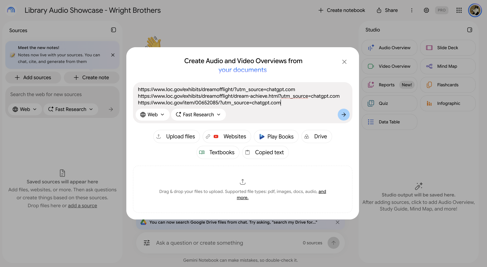
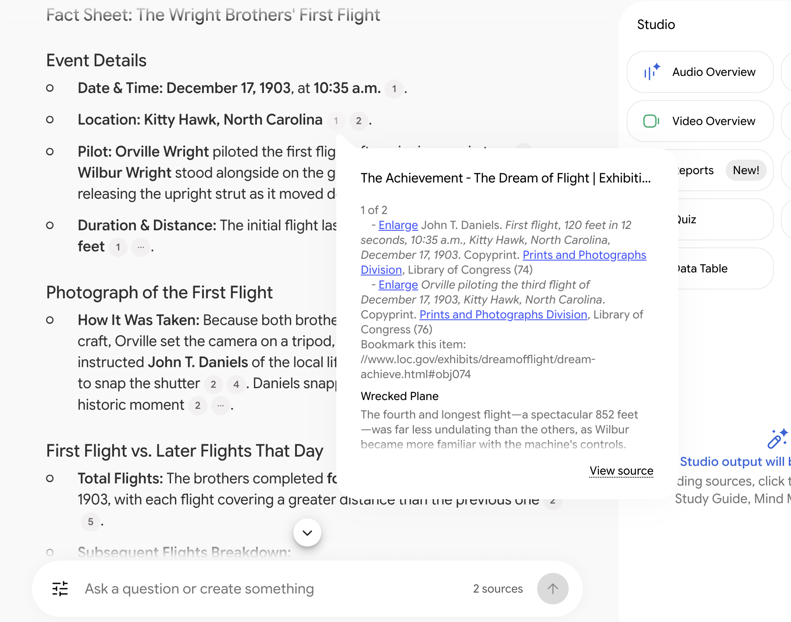
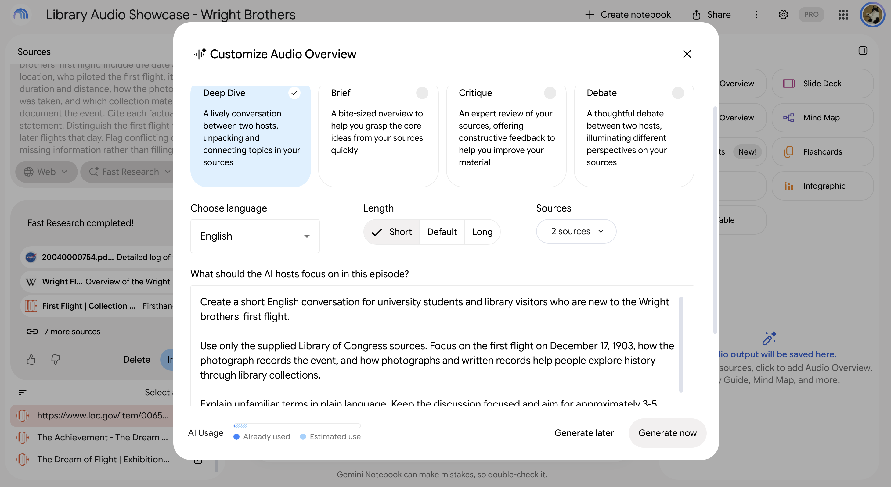

# Library Collections to Audio with NotebookLM

**A small example of turning library collection text into an audio introduction.**
We use materials about the Wright brothers' first flight from the Library of
Congress, ask Google NotebookLM to create a conversation, and check the result
against the sources. The intended audience is library visitors, students, and
teachers who are new to the topic.

## 1. What problem are we trying to solve?

A collection can contain a photograph, a diary, and a telegram about the same
event, spread across several webpages. A visitor needs an easy starting point:
**What happened, why do these materials matter, and where can I learn more?**

This project explores a short audio introduction as that starting point. The
audio tells the basic story and points listeners back to the original collection.
The aim is to make the materials easier to approach; visitor understanding and
staff time savings have not been measured.

## 2. What data did we use?

The source material is **public exhibition text and a photograph catalog
description**. The topic is the Wright brothers' first successful powered flight
on December 17, 1903. Three Library of Congress pages were selected:

| ID | Source | What it contributes |
| --- | --- | --- |
| S1 | [The Dream of Flight](https://www.loc.gov/exhibits/dreamofflight/) | A brief introduction to the event and the exhibition. |
| S2 | [The Achievement](https://www.loc.gov/exhibits/dreamofflight/dream-achieve.html) | The flight story and descriptions of the photograph, Orville's diary, and the family telegram. |
| S3 | [First-flight photograph record](https://www.loc.gov/item/00652085/) | A catalog description identifying the scene, the people, and how the camera was prepared. |

The workflow uses the webpages' text. The records do not establish that the
photograph itself or scans of the diary and telegram were supplied to NotebookLM.
Screenshots show all three source titles, with **two sources selected**; the
exact pair used for each recording was not saved.

A fourth page, [S4: NPS, 1903—The First Flight](https://home.nps.gov/wrbr/learn/historyculture/thefirstflight.htm),
was used to check the sequence of events during review. Its import into
NotebookLM is not confirmed.

## 3. How did we do it?

**Select collection pages → check the facts → generate audio → review → revise.**

1. **Choose a focused story.** Start with the first flight, how its photograph
   was taken, and what the collection preserves about the event.
2. **Add the source URLs to NotebookLM.** Ask for a short fact sheet with
   citations so dates, names, and measurements can be compared with the sources.
3. **Generate a conversation.** Use NotebookLM's Audio Overview to turn the
   material into spoken English. The saved setup screenshot shows **Deep Dive**
   (two hosts), **English**, and **Short**.
4. **Check the output.** The first saved draft lasts **5:07**. The recorded review
   found problems with the coin-toss story, the sequence of attempts, the way the
   photograph was described, and the discussion of newspaper reporting.
5. **Narrow the prompt and review again.** The revised prompt focuses on the
   successful flight, the prepared photograph, and the collection's value. It
   leaves out the coin toss, later flights, and newspaper coverage. The saved
   short version lasts **1:27**, although the prompt requested about three
   minutes. Meizi Song reviewed and approved that short version for this
   showcase on October 31, 2026.

The [prompts](prompts.md) and [review record](review.md) document this process.
The screenshots capture the earlier setup; they do not establish the settings
or complete source selection for every recording.

See the three workflow screenshots

**Add the source URLs**

**Inspect a fact-sheet citation**

**Configure the audio**

See the [screenshot notes](screenshots.md) for the full captions.

## 4. Listen to the audio

These are AI-generated conversations about historical materials. Each M4A link
below opens the audio file directly. Depending on your browser, it will play or
download; you can also right-click the link and choose **Save link as**.

| Recording | Length | Listen or download | Status |
| --- | --- | --- | --- |
| **The Chaos Behind the First Wright Flight** | 5:07 | [Open M4A](https://raw.githubusercontent.com/meizisong888/LIB_showcase/refs/heads/main/library_audio/The_Chaos_Behind_the_First_Wright_Flight.m4a) | First draft, retained for comparison; known factual issues are documented in the review. |
| **How the First Flight Photo Was Taken** | 5:17 | [Open M4A](https://raw.githubusercontent.com/meizisong888/LIB_showcase/refs/heads/main/library_audio/How_the_First_Flight_Photo_Was_Taken.m4a) | Additional recording; its prompt, generation settings, and content review are not documented here. |

**Previously reviewed short version:**
[Listen or download — 1:27, M4A](https://raw.githubusercontent.com/meizisong888/LIB_showcase/refs/heads/main/library_audio/wright-flight-v2.m4a).
The October 31 approval applies to this short recording. Its
[automatic transcript](transcript-v2.md) and [detailed review](review.md#latest-audio-content-review)
are available for reference.

## 5. What does this example show?

Collection text can become an audio introduction that gives visitors another
way into the material. The revision process also shows why a fluent conversation
still needs checking: the first draft included factual problems, and a requested
duration did not determine the actual length.

For a similar project, keep the topic small, retain the original source links,
check the generated claims, and listen to the complete recording before sharing.
This is a worked example; audience testing and measured accuracy or time savings
remain future work.

## Supporting materials

- [Prompts](prompts.md): the fact-checking request and the original and revised audio instructions.
- [Audio review](review.md): measurements, known issues, and the short version's human review.
- [Short-version transcript](transcript-v2.md): automatic transcription, not proofread word for word.
- [Screenshots](screenshots.md): source entry, a citation check, and the audio settings.

Historical materials: Library of Congress. Supplementary fact checking: National
Park Service. Audio generation: Google NotebookLM.
