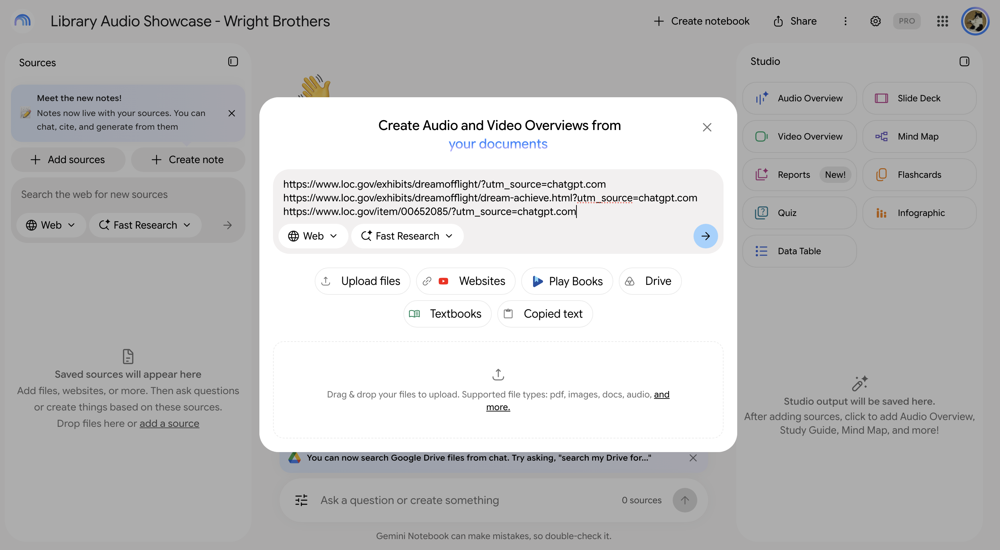
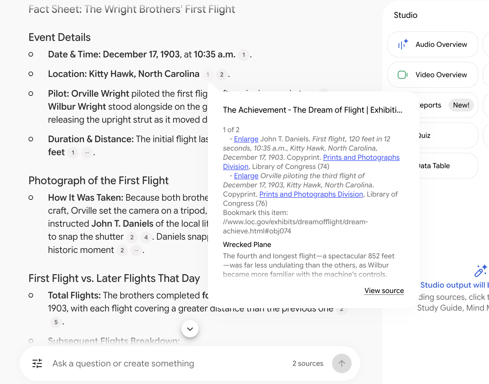
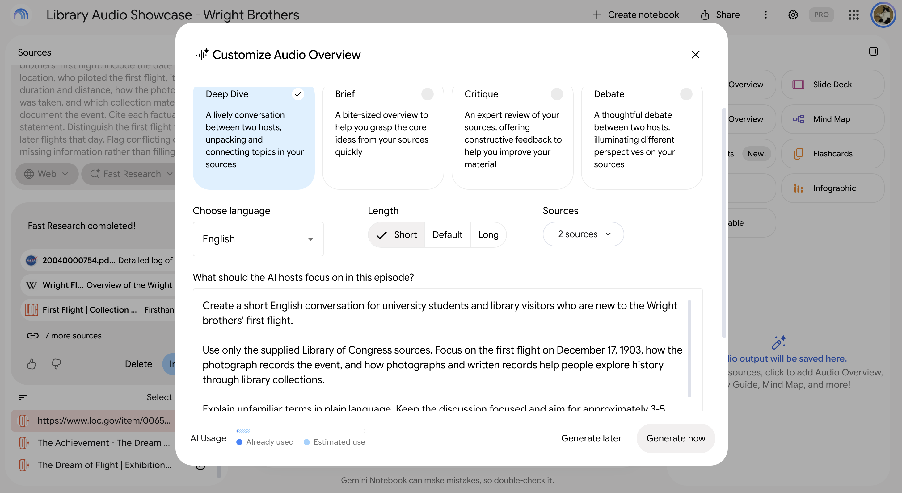

# Screenshot evidence

[Back to the showcase](README.md) · [Prompts](prompts.md) · [Audio review](review.md)

These notes describe the files available on October 31. "Latest recording"
refers to the 1:27 short version, `wright-flight-v2.m4a`. The additional
`How_the_First_Flight_Photo_Was_Taken.m4a` file was added on November 2 and is
not tied to these screenshots.

These are the three original screenshots from the earlier README. All three
GitHub attachment URLs returned HTTP 200 on October 31, 2026. The PNG files are
saved unchanged in this repository. Captions describe what is visible, without
treating a screen as proof that every workflow step was completed.

## 1. Entering the planned source URLs

The notebook is titled **Library Audio Showcase - Wright Brothers**. The entry
box contains the S1–S3 URLs, each with a tracking parameter. **Web** and **Fast
Research** are selected. The background still shows **0 sources**: this captures
URL entry, not completed imports or inspection of the imported text.

[Original GitHub attachment](https://github.com/user-attachments/assets/f67e7d09-6724-4dba-8b5e-3077407d25d4)

## 2. Inspecting a fact-sheet citation

The fact sheet displays the date, location, pilot, flight measurements, and
photograph discussion. An open citation popup shows text from **The Achievement**
(S2), including the first-flight photograph caption. The chat shows **2 sources**.
This establishes that a cited response was displayed and one citation was opened;
it does not establish that every statement or citation was checked.

[Original GitHub attachment](https://github.com/user-attachments/assets/7ac95904-ef84-4e55-ab49-c2a6bf7dc912)

## 3. Configuring an Audio Overview

The visible selections are **Deep Dive** (two hosts), **English**, **Short**, and
**2 sources**. The prompt box shows the beginning of the initial audio prompt,
including its focus on the first flight and collection materials. The lower
source list contains entries corresponding to S1–S3, but the dialog does not
identify which two are selected. A Fast Research results panel is also visible;
listed search results are not proof that those results were imported or used.

The **Generate now** button remains visible. This screen does not prove a
completed generation, the full submitted prompt, or the settings used for the
latest recording. No saved screenshot shows the revised prompt being submitted.

[Original GitHub attachment](https://github.com/user-attachments/assets/d9388336-4fc5-4e7b-be85-72c7ecbdd319)

## Other reported output

The project owner reports an intermediate **24:06** version documented by a
screenshot. That screenshot is not among these three repository attachments,
and its recording is not supplied here. It has not been reviewed. The two M4A
files saved at the time therefore do not represent a count of all generation
attempts.
