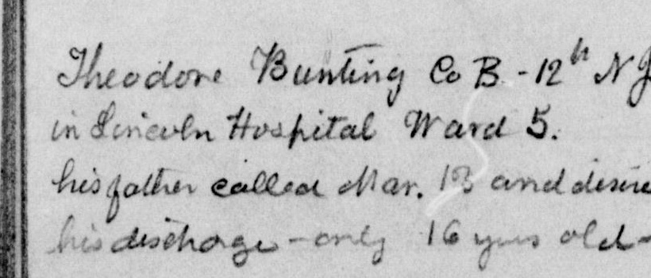
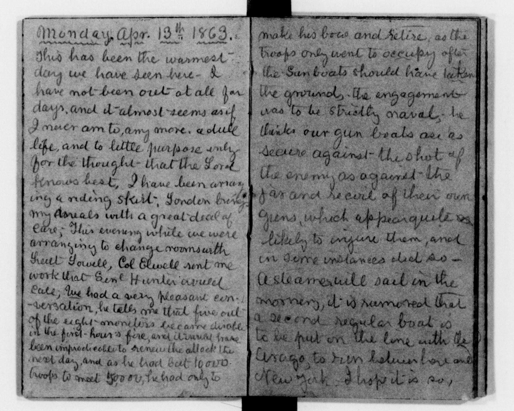
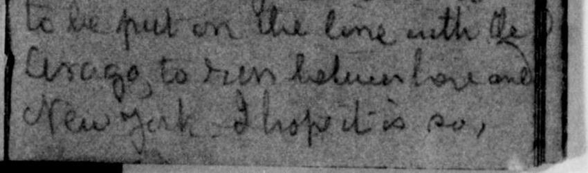

# From Handwriting to Searchable Text

## AI-Assisted Transcription of Historical Library Documents

**Three real Library of Congress scans, three actual AI first passes, and a searchable demonstration with visible corrections.**

[Open the live demonstration](https://meizisong888.github.io/LIB_showcase/library_handwriting/) · [Staff guide](staff-guide.md) · [Copy the prompt](prompts.md)

## 1. The problem

Scanning preserves a historical document, but it does not automatically make its handwriting easy to read or its names searchable. A reader looking for a hospital, a person, or a ship may miss it in a page image.



*Upper-left portion of sample 01, LOC image 12, file 0360. Crop: pixels x=70–890, y=170–520 of the 1874 × 1510 scan, measured from the top left. No text was generated or retouched. [Full source page](https://www.loc.gov/resource/mss11973.001_0349_0380/?sp=12) · [Rights statement](https://findingaids.loc.gov/repositories/19/resources/2059).*

## 2. What this project does

AI can turn difficult-to-read historical handwriting into readable draft transcriptions, helping readers understand the content and giving library staff a starting point for review.

This workflow takes a historical handwriting scan and produces a first-pass AI transcription, a comparison with a public reference, a reference-checked text, and a short introduction. The checked text can be searched and downloaded without an online model or server.

For an initial reading, a draft can help readers understand the general content. For accurate quotation, cataloging, and search, names, dates, places, and other important details still need checking against the scan.

This is an **AI-assisted library preparation showcase**, not a new recognition algorithm or a representative performance study. It uses three deliberately selected digital images from the **Clara Barton Papers**. Two images show a two-page spread; “page” below means the identified LOC digital image, not necessarily one physical leaf.

**The three text versions are different:**

| Record | What it means here |
| --- | --- |
| AI first pass | The unchanged image-only output, saved before reference access. |
| Public reference | LOC text attributed to transcription and review by By the People contributors. |
| Reference-checked text | This project's AI-prepared comparison and editing, with unresolved readings marked. |

## 3. How it works

1. **Select a document →** inspect the real scan, its reuse rights, its exact image number, and the availability of a matching reference. This prevents comparing a page with someone else's text.
2. **Transcribe with AI →** provide only the image and a common prompt. Preserve spelling and line order, mark uncertain words, and save the first answer before opening the reference.
3. **Compare and correct →** use Python to expose differences, then inspect them against the scan and public reference. Keep unresolved readings visible; a reference can also be wrong.
4. **Search and reuse →** save text with its source ID, then search names and keywords or prepare an index and short reader introduction. Human review is still needed before treating uncertain readings as authoritative.

These samples have existing public transcriptions, which allow us to compare the AI’s first-pass output with a reference. The intended application is to assist with documents that do not yet have transcriptions. Here, the existing texts let us test and demonstrate AI reading, rather than repeat completed transcription work.

The AI’s first pass did not read the references. They were used only afterward for comparison and assisted correction, and can contain errors. Reference-assisted corrections do not show what AI would achieve independently on documents without references.

## 4. See one complete example

**Sample 03: diary entry headed Monday, April 13, 1863.** The writing is dense and uneven in contrast. The complete entry spans both sides of this scan and can be read on its own. The category describes this particular image, not all of Barton's writing.

[LOC image 12, file 0392](https://www.loc.gov/resource/mss11973.001_0381_0444/?sp=12) · [Reference view](https://www.loc.gov/resource/mss11973.001_0381_0444/?sp=12&st=text) · [LOC reference download](https://tile.loc.gov/storage-services/service/gdc/gdccrowd/mss/mss11973/001/0300/0392.txt)



*Complete, unretouched LOC JPEG, 1741 × 1393 pixels. Open the image for full size. Clara Barton Papers: Diaries and Journals: 1863, Apr. 2–July 23; image 12. [Source](https://www.loc.gov/resource/mss11973.001_0381_0444/?sp=12) · [Download](https://tile.loc.gov/storage-services/service/mss/mss11973/001/0300/0392.jpg) · [Rights](https://findingaids.loc.gov/repositories/19/resources/2059). The [demo](https://meizisong888.github.io/LIB_showcase/library_handwriting/#sample-03) provides a scan-and-text layout.*

### AI first pass — complete and unchanged

This was produced by direct image reading in a fresh Codex context. Brackets are part of the actual saved output. The model's [separate notes](data/ai-original/03-notes.txt) identify difficult names and layout decisions.

```text
Monday. Apr. 13ᵗʰ 1863.
This has been the warmest
day we have seen here - I
have not been out at all for
days, and it almost seems as if
I never am to, any more. a dull
life, and to little purpose only -
for the thought - that the Lord
knows best, I have been arrang
ing a riding skirt; [uncertain: Jorden] [uncertain: brings]
my meals with a great deal of
care; This evening while we were
arranging to change rooms with
Lieut Lowell, Col Elwell sent me
word that Genˡ Hunter would
call; We had a very pleasant con-
-versation, he tells me that five out
of the eight monitors became [uncertain: disabled]
in the first-hour's fire, and it would have
been impracticable to renew the attack the
next day, and as he had but 10000.
troops to meet 50000, he had only to

make his bow and retire, as the
troops only went to occupy after
the Gun boats should have taken
the ground, the engagement
was to be strictly naval, he
thinks our gun boats are as
secure against the Shot of
the enemy, as against the
jar and recoil of their own
guns, which appear quite as
likely to injure them, and
in some instances did so -
A steamer will sail in the
morning, it is rumored that
a second regular boat is
to be put on the line with the
George to run between here and
New York. I hope it is so,
```

### Public reference — complete transcription body

The LOC resource API attributes this exact page's reference to **transcription and review by By the People contributors**; the [saved attribution](data/source-evidence/03-attribution.json) preserves that evidence. We did not observe the live Crowd status badge because that site returned HTTP 403. The following text preserves the download's spelling and punctuation; CRLF line endings are converted to LF and invisible line-end spaces are omitted in this README display. The separate reference TXT preserves those spaces. The [original downloaded bytes](data/reference/03-download.txt) are retained.

```text
Monday Apr. 13th 1863
This has been the warmest
day we have seen here - I
have not been out at all for
days, and it almost seems as if
I never am to, any more. a dull
life, and to little purpose only
for the thought that the Lord
knows best. I have been arranging
 a riding skirt, London brings
my meals with a great deal of
care; This evening while we were
arranging to change rooms with
Lieut. Lowell, Col Elwell sent me
work that Genl Hunter would
call, We had a very pleasant conversation,
he tells me that five out
of the eight Monitors become disabled
in the first hour's fire, and it would have
been impracticable to renew the attack the
next day, and as he had but 10 000
troops to meet 50,000, he had only to

make his bow and retire as the
troops only went to occupy after
the Gunboats should have taken
the grounds. The engagement
was to be strictly naval; he
thinks our gun boats are as
secure against the shot of
the enemy as against the
jar and recoil of their own
guns, which appear quite as
likely to injure them, and
in some instances did so -
A steamer will sail in the
morning, it is rumored that
a second regular boat is
to be put on the line with the
Arago, to run between here and
New York. I hope it is so,
```

### What worked, what differed, and why checking matters

Some differences in punctuation, spacing, line breaks, and abbreviation forms may not prevent understanding. Others change the content and can affect interpretation and search. The `George` / `Arago` ship-name error below shows how one misread name can cause a keyword search to miss a page.

| Location | Actual AI first pass | Published reference | Decision and significance |
| --- | --- | --- | --- |
| Final line | `New York` | `New York` | Correctly recognized; immediately useful as a place search term. |
| Right page, second-last line | `George` | `Arago,` | Adopted `Arago,` after comparing the scan. The fluent first-pass ship name was wrong relative to the reference; searching for Arago in that first pass would fail. |
| Left page, riding-skirt line | `[uncertain: Jorden] [uncertain: brings]` | `London brings` | Adopted `brings`; retained `[uncertain: London]` because the personal name remains visually difficult. No identity is inferred. |
| Left page, message from Elwell | `word` | `work` | Preserved `[uncertain: work / word]`. Do not silently turn the reference's possibly mistaken word into an established reading. |
| Left page, troop numbers | `10000.` / `50000,` | `10 000` / `50,000,` | Formatting differences, not different quantities. These still contribute to the declared metrics. |
| Left page, word wrapping | `arrang` / `ing`, `con-` / `-versation` | Joined words with different wrapping | Transcription conventions also contribute to disagreement; the scoring does not silently remove them. |



*Lower-right detail of the same complete scan, x=830–1680, y=1110–1360. This is an exact crop, without contrast enhancement. It supports inspection of the `George` → `Arago` correction. [Source](https://www.loc.gov/resource/mss11973.001_0381_0444/?sp=12) · [Rights](https://findingaids.loc.gov/repositories/19/resources/2059).*

[Full line diff](results/03-line-diff.txt) · [Word diff in the live demo](https://meizisong888.github.io/LIB_showcase/library_handwriting/#sample-03) · [All sample review decisions](results/review.json)

### Text checked against the reference — complete

The checked version follows the reference's spelling and line segmentation, with the two unresolved readings explicitly marked. It is an AI-prepared working text, not a human-certified edition. The unchanged first pass above remains available separately.

```text
Monday Apr. 13th 1863
This has been the warmest
day we have seen here - I
have not been out at all for
days, and it almost seems as if
I never am to, any more. a dull
life, and to little purpose only
for the thought that the Lord
knows best. I have been arranging
 a riding skirt, [uncertain: London] brings
my meals with a great deal of
care; This evening while we were
arranging to change rooms with
Lieut. Lowell, Col Elwell sent me
[uncertain: work / word] that Genl Hunter would
call, We had a very pleasant conversation,
he tells me that five out
of the eight Monitors become disabled
in the first hour's fire, and it would have
been impracticable to renew the attack the
next day, and as he had but 10 000
troops to meet 50,000, he had only to

make his bow and retire as the
troops only went to occupy after
the Gunboats should have taken
the grounds. The engagement
was to be strictly naval; he
thinks our gun boats are as
secure against the shot of
the enemy as against the
jar and recoil of their own
guns, which appear quite as
likely to injure them, and
in some instances did so -
A steamer will sail in the
morning, it is rumored that
a second regular boat is
to be put on the line with the
Arago, to run between here and
New York. I hope it is so,
```

### Modern English introduction

Barton describes a warm day spent indoors, work on a riding skirt, and a visit from General Hunter. She records his account of damage to monitors and the limits on an attack. She ends by mentioning a rumored additional boat service with the Arago to New York. This introduction summarizes the checked diary text; it does not independently verify the reported military events or identify the uncertain name.

## 5. Results across three pages

Across these three examples, AI produced useful draft transcriptions that make much of the handwritten content easier to read. The examples also show why names, dates, and other important details need verification.

These are **first-pass AI versus public-reference** comparisons, not scores for the checked version. Every selected page is included. The faint page did not have the highest error rates: page length, names, punctuation, abbreviations, and explicit uncertainty all affect this small comparison.

| Sample | What it illustrates | Reference words | CER (edits / characters) | WER (edits / words) | AI uncertainty markers |
| --- | --- | ---: | ---: | ---: | ---: |
| [01](data/checked/01.txt) | Clearer short notes | 37 | 12.17% (23/189) | 27.03% (10/37) | 1 |
| [02](data/checked/02.txt) | Names and abbreviations | 112 | 16.86% (119/706) | 46.43% (52/112) | 5 |
| [03](data/checked/03.txt) | Faint, dense diary entry | 245 | 6.28% (77/1227) | 13.88% (34/245) | 3 |

- **01 — Short notes:** a hospital note and a clothing list, with clearer spacing but a disputed faint date. The volume is cataloged Jan.–Feb. 1863, while the note itself says `Mar.`; the inconsistency is retained.
- **02 — Names and abbreviations:** an undated address list. Letter shapes are relatively bold, yet proper names, raised abbreviation letters, punctuation and ditto marks need interpretation.
- **03 — Faint diary:** a complete April 13, 1863 entry across a spread, with dense, uneven writing and words split at line endings.

**Scoring rules.** Python applies Unicode NFC, case folding, and whitespace collapse (including newlines) to comparison copies only. Punctuation, digits, superscript letters, hyphens, and all `[uncertain: …]` / `[illegible]` markers remain. CER is character edit distance divided by reference characters, including normalized spaces. WER is edit distance between whitespace-separated tokens divided by reference tokens. Substitution, deletion and insertion each cost one. No dehyphenation or abbreviation expansion is performed. These rules are deliberately conservative and penalize explicit uncertainty and formatting differences. **Neither 1 − CER nor 1 − WER is presented as factual accuracy.**

The references are reliable, page-matched comparison material, not absolute ground truth. Sample 01's date, sample 02's `O.D.b.`, and sample 03's `work` are documented review concerns. The sample count cannot establish performance across historical collections. No staff time, efficiency gains, or monetary savings were measured.

[Reproducible CSV](results/comparison.csv) · [Evaluation notes](results/evaluation-notes.md) · [All checked text](results/searchable-text.txt)

## 6. What becomes possible

In the [live demo](https://meizisong888.github.io/LIB_showcase/library_handwriting/#search), search **Lincoln**. It returns **sample 01**, checked-text line 2:

> in Lincoln Hospital Ward 5.

The hit links back to its exact scan. Search **Arago** to find sample 03 and the corrected line:

> Arago, to run between here and

The full entry ends with `New York. I hope it is so,`. This is a practical reason to check a transcription: the original AI's `George` would not support this ship-name search.

Library staff could use the linked text to prepare names-and-places indexes, organize material by topic, or draft short reader introductions. Search covers only the three checked texts. It is a literal, case-insensitive search; it does not resolve abbreviated names, join split words, or verify uncertain readings.

## 7. Staff guide

Choose a page with suitable reuse rights, save its source and image number, upload the image to an approved image-capable tool, and use the prompt below. Save the first response before checking a reference. Inspect uncertain words **and plausible-looking names** against the scan, record disagreements, and retain the image, original AI output, reference, checked text, and provenance together.

```text
Transcribe all visible writing in this historical document image.
Preserve the original spelling, capitalization, punctuation, and line order.
Read a spread left page first, then right page; separate the pages with a blank line.
Do not translate, paraphrase, modernize, or complete missing content.
Mark a tentative word as [uncertain: word]. Use [illegible] when you cannot read it.
Keep visible ditto marks as marks; do not silently expand them.
Represent readable crossed-out text as [deleted: text] and insertions as
[inserted: text]. Do not invent text beneath an unreadable deletion.
Include visible headings, dates, marginal writing, and numbers.
Return two separate sections: TRANSCRIPTION (only the transcription) and
NOTES (reading uncertainties or layout observations, without historical guesses).
```

[Full staff guide and concrete human-review checklist](staff-guide.md) · [Canonical prompt](prompts.md)

## 8. Sources and reproduction

### Exact source pages

Creator: **Clara Barton**, as attributed by the catalog. Collection: **Clara Barton Papers, Manuscript Division, Library of Congress**.

| Sample | Catalog title and page identifier | Scan / reference |
| --- | --- | --- |
| 01 | *Clara Barton Papers: Diaries and Journals: 1863, Jan.–Feb.* — image 12 of 32, file `0360`, a two-page spread. The note's March day is unresolved. | [Page](https://www.loc.gov/resource/mss11973.001_0349_0380/?sp=12) · [JPEG](https://tile.loc.gov/storage-services/service/mss/mss11973/001/0300/0360.jpg) · [Reference TXT](https://tile.loc.gov/storage-services/service/gdc/gdccrowd/mss/mss11973/001/0300/0360.txt) |
| 02 | *Clara Barton Papers: Diaries and Journals: 1863, Jan.–Feb.* — image 8 of 32, file `0356`, one address page; no date on the page. | [Page](https://www.loc.gov/resource/mss11973.001_0349_0380/?sp=8) · [JPEG](https://tile.loc.gov/storage-services/service/mss/mss11973/001/0300/0356.jpg) · [Reference TXT](https://tile.loc.gov/storage-services/service/gdc/gdccrowd/mss/mss11973/001/0300/0356.txt) |
| 03 | *Clara Barton Papers: Diaries and Journals: 1863, Apr. 2–July 23* — image 12 of 64, file `0392`, a two-page entry dated April 13, 1863. | [Page](https://www.loc.gov/resource/mss11973.001_0381_0444/?sp=12) · [JPEG](https://tile.loc.gov/storage-services/service/mss/mss11973/001/0300/0392.jpg) · [Reference TXT](https://tile.loc.gov/storage-services/service/gdc/gdccrowd/mss/mss11973/001/0300/0392.txt) |

**Rights are checked separately from availability.** LOC's [collection finding aid](https://findingaids.loc.gov/repositories/19/resources/2059) states that copyright in Barton's unpublished writings in its custody has been dedicated to the public; the same statement was verified in the [official PDF finding aid](https://tile.loc.gov/storage-services/service/mss/eadxmlmss/eadpdfmss/2005/ms005010.pdf). That is the basis for reusing these cataloged diary pages, not a blanket assumption about LOC collections. The [LOC Concordia repository](https://github.com/LibraryOfCongress/concordia#readme) states that By the People transcriptions are released into the public domain. Project code and original explanatory content follow the repository's MIT license; it does not replace the source materials' rights statements.

Each sample's reference status, rights links, item date, observed page date, source URLs, dimensions and checksums are in [sources.json](data/sources.json). [Selected-page API mappings and review attributions](data/source-evidence/) establish that the image and TXT correspond. Some human-facing LOC pages and Crowd returned HTTP 403 in this environment; the official JSON, JPEG, TXT, and finding-aid PDF were actually downloaded. No AI transcription was submitted to LOC or By the People.

### Actual AI run

Run date: **November 7, 2026 (UTC)**. Tool: **Codex direct image understanding through `view_image`, original detail**. Runtime instructions identify Codex as GPT-6 based, but the exact serving model/version was not exposed; it is not claimed. One fresh context, with no inherited research conversation, read the same prompt and the three images separately, saving each first response before moving to the next. It did not receive source titles, references, preexisting answers, or web results. Its own earlier page outputs remained in the same isolated context. The reference downloads for comparison occurred after all three outputs were saved.

The source-selection context had fetched other diary material, so isolation was used to avoid reference leakage. Model pretraining exposure cannot be ruled out. Token usage, inference duration and cost were **not recorded**; no estimates are reported as measurements. No additional model service was purchased. [Run information](results/run-info.json) · [Execution record](results/transcription-execution.json) · [Immutable-evidence checksums](results/evidence-sha256.json)

### Reproduce the deterministic work

From the repository root, using Python 3.10 or newer:

```bash
python library_handwriting/scripts/build.py
python library_handwriting/scripts/validate.py
python library_handwriting/scripts/search.py Lincoln
python library_handwriting/scripts/search.py Arago
```

These commands need only the Python standard library. They verify preserved inputs and image/reference mappings, recompute CER/WER and full differences, and regenerate the searchable file, README and static HTML. Open `library_handwriting/index.html` directly in a browser; search works offline. Pillow is optional and needed only to recreate exact crops with `python library_handwriting/scripts/make_crops.py`.

The checked texts and review decisions are retained editorial inputs, not recomputed guesses. `site/readme.template.md` and `site/index.template.html` are build sources; `README.md` is the main presentation. To re-download source evidence without overwriting it, use `python library_handwriting/scripts/fetch_sources.py --output /tmp/handwriting-source-check` (network required).

To build the existing GitHub Pages site, run the repository's normal `npm ci` and `npm run build`. Browser interaction and accessibility checks use the repository’s existing Playwright and axe dependencies: `node library_handwriting/scripts/check-browser.mjs` after starting a local HTTP server on port 8766. The recorded check covers all text versions, actual search hits, keyboard submission, a 390-pixel mobile viewport and offline file access.

The build copies this self-contained showcase into `dist/library_handwriting/` and preserves the root guide and SkillPrompt routes. Deployment uses the existing `main`-branch workflow.

**AI transcription is a separate, nondeterministic step.** Repeat it in a fresh image-capable session with the prompt and scans, saving outputs in a new run directory. Do not overwrite `data/ai-original/` or feed references into that first pass. The Python commands reproduce this recorded comparison; they do not rerun a model or promise identical future transcriptions.
