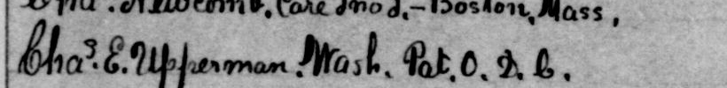
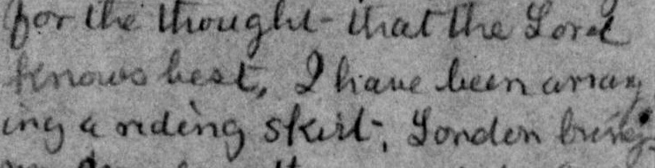

# Evaluation notes

## What was compared

All three unchanged AI first passes are compared with the corresponding published LOC/By the People page text. Each resource response explicitly attributes its text to transcription and review by By the People contributors; the exact page attribution and image/text mapping are saved in `data/source-evidence/`. This is prior volunteer review of the public reference, not new human review of this project. Live Crowd status badges were inaccessible.

Pages were selected visually before reference comparison: a short hospital note with a supply list, an address page, and a complete diary entry. They are convenient illustrations of different reading problems, not a random sample or a claim about all historical documents. The second sample has bold handwriting but challenging names and abbreviations. Two digital images contain spreads. Reading order is left page then right page, and top then bottom for the address page.

## Exact comparison policy

- Reference download bytes are preserved as `data/reference/ID-download.txt`. Display copies use UTF-8 with CRLF changed to LF and one final newline; their content is otherwise unchanged.
- Evaluation uses Unicode NFC, Unicode case folding and whitespace collapse. All line boundaries become spaces, and repeated spaces become one. Leading/trailing whitespace is removed.
- Punctuation, ditto marks, superscript characters, word splits, numbers, brackets and uncertainty labels are retained. There is no accent stripping, punctuation deletion, dehyphenation, spelling correction or abbreviation expansion.
- CER is Levenshtein distance over normalized characters divided by the number of reference characters (spaces included). WER uses whitespace-separated tokens and the number of reference tokens as denominator. Each insertion, deletion or substitution costs one.
- `1 − WER` is not labeled accuracy. WER can exceed 100% for some outputs. Uncertainty counts include each `[uncertain: …]` and `[illegible]` occurrence. This run has 1, 5 and 3 markers respectively and no `[illegible]` occurrences.
- Full line diffs preserve line order. The word-diff display uses `difflib.SequenceMatcher` to show raw-text changes; its alignment is explanatory and is **not** the Levenshtein scoring algorithm.

The numbers in [comparison.csv](comparison.csv) are generated by `scripts/build.py`. Short texts and the many punctuation/abbreviation differences on the address page make its WER especially sensitive to conventions. The uncertainty notation itself also adds scored tokens. The numeric ranking is not a ranking of inherent image difficulty.

## Reference and editorial limits

**01 — Date.** The first pass says `[uncertain: 18]`; the reference says `1st`. The scan's faint characters prompted a tentative `13` in the reference-checked copy. This remains `[uncertain: 13]`, not a definitive correction. The note says `Mar.` inside an item titled Jan.–Feb. 1863; neither date is silently changed. Its supplies and hospital sentences are intelligible without surrounding pages.

**02 — Names and addresses.** The reference's `Harriot` and `Hightown` remain uncertain in the checked text. `P.M.` and the ordinary `Chas.` / `Wm.` spellings follow the reference, while the original superscripts and tentative readings remain preserved in the first pass. The reference's `Pat. O.D.b.` appears inconsistent with the image's `Pat. O. D. C.`. The checked text marks `[uncertain: D.C.]`. The reference also renders the second Mrs. ditto mark as two apostrophes and absorbs the above-line `the people` into running text; those are editorial representation choices, not necessarily lexical recognition failures. No abbreviated place name or personal identity is expanded.

*Sample 02, lower address block, x=80–900, y=1540–1640 of the 1529 × 1921 scan. Exact crop. [Source image 8, file 0356](https://www.loc.gov/resource/mss11973.001_0349_0380/?sp=8) · [Rights](https://findingaids.loc.gov/repositories/19/resources/2059).*

**03 — Name, message, ship and wrapping.** `George` becomes the reference's `Arago,` after image comparison. `London` remains uncertain, and `work / word` is left unresolved. The checked copy otherwise follows the published reference, including `become`, `grounds`, its punctuation and word joining; this is not a claim that each reference convention is uniquely correct. In particular, `arranging` and `conversation` are split differently in the first pass and reference, and the troop numbers have different spacing. These are retained in the metric rather than selectively normalized away. The modern introduction reports what the entry says; it does not establish which engagement occurred or validate its troop figures.

*Sample 03, middle-left detail, x=100–840, y=530–720 of the 1741 × 1393 scan. Exact crop. [Source image 12, file 0392](https://www.loc.gov/resource/mss11973.001_0381_0444/?sp=12) · [Rights](https://findingaids.loc.gov/repositories/19/resources/2059).*

No new human review, time study or financial measurement was performed. Exact serving model version, per-page token usage, latency and cost were not exposed or recorded. Isolating the initial reading removes reference text supplied during this task; it cannot exclude possible pretraining exposure. All checked outputs still need the specific human review listed in the [staff guide](../staff-guide.md).
